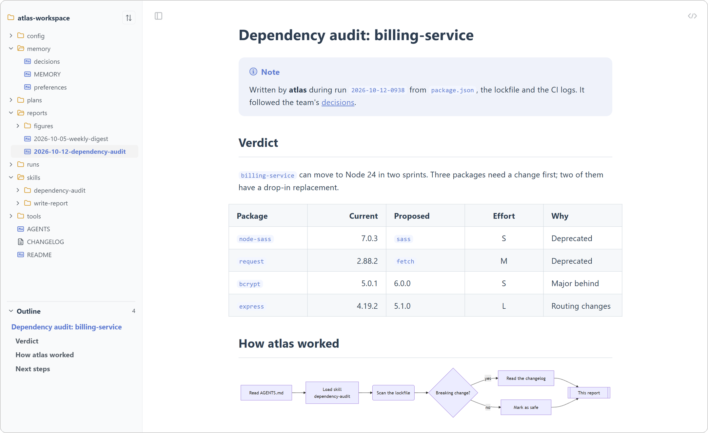
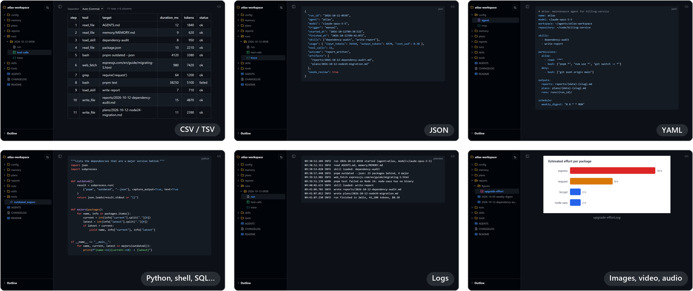
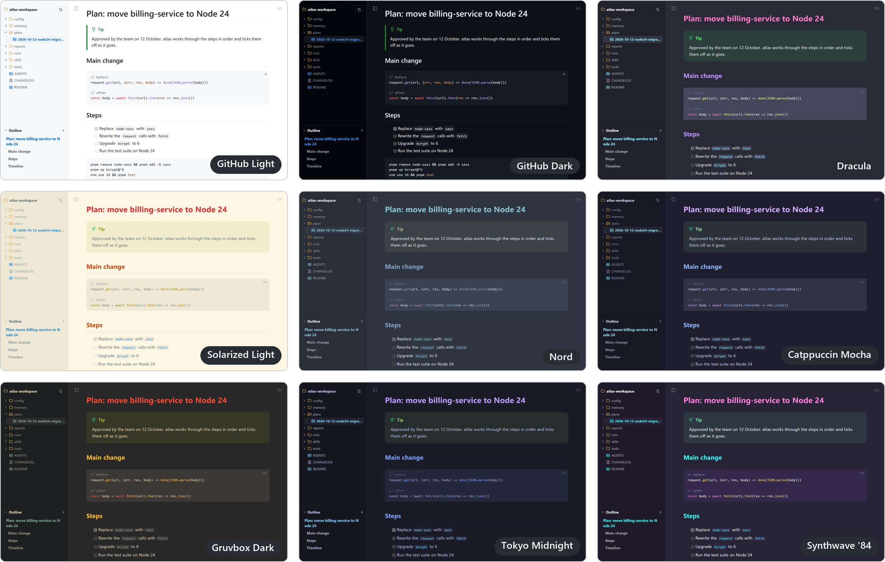
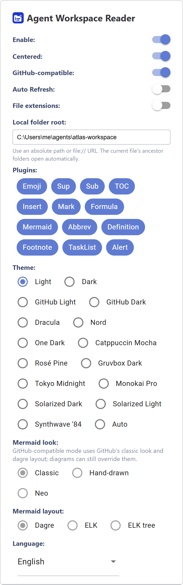

<div align="center">


# Agent Workspace Reader

**Read the folders your AI agents write to, right in the browser: reports, plans, memory, skills, run logs, CSV and code, with a folder tree and wiki links.**

[](LICENSE)
[](package.json)
[](src/manifest.json)
[](#-installation)
[](https://github.com/adamotte/agent-workspace-reader/actions/workflows/build.yml)
[](https://github.com/adamotte/agent-workspace-reader/commits/main)

English | [Français](./README-fr.md)

</div>



Coding and research agents (Claude Code, Codex, Copilot, Cursor…) leave their work in plain files: an `AGENTS.md`, a `memory/` folder, `SKILL.md` files, plans, reports, run logs, traces and CSV exports. Agent Workspace Reader makes such a folder readable: open any of its files from a `file://` URL and the extension renders it, with the whole workspace in a side panel.

<!-- prettier-ignore -->
> [!NOTE]
> **Local, and read-only unless you edit.** The extension only runs on `file://` URLs and needs no permission beyond storing its own settings. It never uploads your files, and it doesn't load remote images or stylesheets: opening a document never contacts another host. The only writes are the files you save from its [edit mode](#%EF%B8%8F-edit-in-place), inside a folder you granted through the browser's own folder dialog. A remote or missing image shows its alt text instead, so badges still read.

---

## ✨ Features

### 📂 Browse the whole workspace

- 🌳 **Folder tree** from a root folder down to the current file, with its ancestors expanded and the file highlighted
- ⚡ **Files open in place**: clicking through the tree switches the document without reloading the page, and back and forward follow
- 🏷️ **Type icons** for every file, extensions hidden or shown, sorted by name or modified time
- 🔗 **Wiki links**: `[[decisions]]` and `[[skills/write-report/SKILL|write-report]]` resolve to the matching file under the root
- 🧭 **Outline** of the current document, and a resizable side panel

### 📝 Markdown the way GitHub shows it

- ✅ **GitHub-compatible mode**, on by default: alerts, task lists, tables, footnotes, front matter and heading anchors, plus a banner listing what GitHub would render differently
- 📊 **Diagrams and math**: Mermaid (classic, hand-drawn or neo look; dagre or ELK layout), Graphviz and KaTeX
- 🧩 **Syntax plugins**: emoji, superscript, insertions, highlights and containers; with GitHub mode off, also subscript, abbreviations, definition lists, a `[[toc]]` table of contents and extended tables
- 📋 **Code blocks** highlighted with a copy button, an image viewer and a raw source toggle

### 🗂️ More than Markdown



| Kind            | Files                                                                                                                | Shown as                                          |
| --------------- | -------------------------------------------------------------------------------------------------------------------- | ------------------------------------------------- |
| Markdown        | `.md` `.mdx` `.mdc` `.mkd` `.markdown`                                                                               | Rendered document                                 |
| Text            | `.txt`, `README`, `LICENSE`, `CHANGELOG`, `NOTICE`, `AUTHORS`, `COPYING`                                             | Rendered document                                 |
| Data and config | `.json` `.yaml` `.yml` `.toml` `.ini` `.cfg` `.conf` `.properties` `.xml`                                            | Highlighted code                                  |
| Code            | `.py` `.js` `.ts` `.sh` `.ps1` `.bat` `.sql` `.go` `.rs` `.java` `.c` `.cpp` `.cs` `.css`…, `Dockerfile`, `Makefile` | Highlighted code                                  |
| Logs            | `.log`                                                                                                               | Plain text                                        |
| Tables          | `.csv` `.tsv`                                                                                                        | Table, with the separator detected and adjustable |
| Media           | Images (`.png` `.jpg` `.svg` `.webp`…), video (`.mp4` `.webm`), audio (`.mp3` `.wav` `.flac`…)                       | Viewer or player in the page                      |
| Browser formats | `.html` `.pdf`                                                                                                       | The browser's own viewer, in a new tab            |

### 🎨 15 themes



Light, Dark, GitHub Light, GitHub Dark, Dracula, Nord, One Dark, Catppuccin Mocha, Rosé Pine, Gruvbox Dark, Tokyo Midnight, Monokai Pro, Solarized Dark, Solarized Light and Synthwave '84, or **Auto** to follow the system. Code highlighting follows the theme.

### ✏️ Edit in place

- 📝 **Edit button** on any text file: Markdown, text, code, config, logs, CSV and TSV. Images, video, audio, PDF and HTML stay read-only.
- 🪟 **Editor beside the rendered page**: CodeMirror with line numbers, syntax highlighting, search and undo on the left, the live preview on the right, or the editor alone with the preview hidden
- 💾 **Explicit saves** with <kbd>Ctrl</kbd>+<kbd>S</kbd> or the Save button; an unsaved-changes dot, and a confirmation before leaving with changes
- 🤝 **Agent-aware**: if an agent writes the file while you edit it, the editor reloads it when you have no changes, and otherwise asks whether to reload or save anyway

### 🛋️ Reading comfort

- 🔄 **Hot reload**: the page updates as the agent writes the file
- 📐 **Centered layout** for long documents
- ⌨️ **Keyboard shortcuts** for the side panel, layout, hot reload and theme
- 🌐 **English and French** interface

---

## 📦 Installation

Agent Workspace Reader isn't published on extension stores yet. Download `agent-workspace-reader-<date>.zip` from the [latest release](https://github.com/adamotte/agent-workspace-reader/releases/latest) and unzip it into a folder you'll keep, for example `agent-workspace-reader/`: the extension loads from that folder. Then, in Chrome or Edge:

1. Open `chrome://extensions/` (or `edge://extensions/`) and turn on **Developer mode**.
2. Click **Load unpacked** and select the unzipped folder.
3. Open the extension's **Details** and turn on **Allow access to file URLs**: browsers keep extensions away from local files by default.

To update, unzip the new release over the same folder and click the extension's reload button on `chrome://extensions/`.

You can also [build it from source](#%EF%B8%8F-development).

## 🔧 Configuration



Click the extension icon to open its settings:

1. **Workspace**: set it to your agent's workspace folder, for example `C:\Users\me\agents\atlas` or `/Users/me/agents/atlas`. The side panel then keeps the tree from that root, and bare wiki links such as `[[decisions]]` are looked up under it.
2. **Theme**: pick one of the 15 themes, or Auto.
3. **Auto Refresh**, on by default: the page follows a file while an agent writes it.
4. **GitHub-compatible**: turn it off for the syntax GitHub doesn't support and to choose the Mermaid look and layout.
5. **Plugins**: turn individual syntax plugins on or off.
6. **File extensions**, shown by default in the tree next to the type icons: turn them off for bare names.
7. **Editing**, off by default: turn it on to edit text files in the page. Its section holds the **Allow saving files…** button and the list of granted folders.

Then open a file or a folder, such as `file:///C:/Users/me/agents/atlas/AGENTS.md`, or drag a file into the browser.

**Granting write access.** With editing on, click **Allow saving files…** in the popup, or just click **Edit** (or press <kbd>Alt</kbd>+<kbd>Shift</kbd>+<kbd>E</kbd>) on a file; with editing off, the pencil offers to turn it on first. The browser's folder dialog then opens: choose the folder the page names, your workspace or the file's own folder, or any folder above it. That one grant covers every file under the folder you chose. Browsers forget the grant when they close; the next **Edit** then only asks for confirmation. The browser refuses a few folders, such as your user profile root or system folders: set a sub-folder as the workspace instead.

To try it, set the root to the [`example/atlas-workspace`](./example/atlas-workspace) folder of this repository, the workspace shown in the screenshots, and open its `AGENTS.md`.

[LOCAL_BUILD.md](./LOCAL_BUILD.md) details how the folder browser behaves.

<br clear="right">

## ⌨️ Keyboard shortcuts

| Shortcut                                     | Action                                   |
| -------------------------------------------- | ---------------------------------------- |
| <kbd>Alt</kbd>+<kbd>Shift</kbd>+<kbd>B</kbd> | Show or hide the side panel              |
| <kbd>Alt</kbd>+<kbd>Shift</kbd>+<kbd>C</kbd> | Toggle the centered layout               |
| <kbd>Alt</kbd>+<kbd>Shift</kbd>+<kbd>R</kbd> | Toggle hot reload                        |
| <kbd>Alt</kbd>+<kbd>Shift</kbd>+<kbd>T</kbd> | Switch between the Light and Dark themes |

Change them at `chrome://extensions/shortcuts` (or `edge://extensions/shortcuts`). In the page, <kbd>Alt</kbd>+<kbd>Shift</kbd>+<kbd>E</kbd> opens or closes the editor, <kbd>Ctrl</kbd>+<kbd>S</kbd> saves and <kbd>Esc</kbd> closes it.

## ⚠️ Known limitations

- **Chromium only**: tested on Chrome and Edge. Firefox and Safari aren't supported.
- **Hidden folders**: the tree skips folders whose name starts with a dot, such as `.claude/` or `.codex/`, and `node_modules/`. Their files still open from their URL.
- **Unknown file types**, such as `.jsonl`, aren't listed in the tree.
- **Large tables**: a CSV or TSV view shows its first 5,000 rows.
- **Remote content**: remote images and stylesheets aren't loaded, by design. Links to remote pages still work.
- **Editing**: files are saved as UTF-8 without a byte order mark, with their original line endings. There is no "Save as"; the editor writes the file it shows.
- **Markdown Reader**: if the original md-reader extension is installed, disable it so that the two extensions don't both render the same page.

## 🛠️ Development

Building needs Node.js 16 or later and [pnpm](https://pnpm.io):

```bash
git clone https://github.com/adamotte/agent-workspace-reader.git
cd agent-workspace-reader
pnpm install
pnpm build
```

The unpacked extension lands in `extension/`, which you can load with **Load unpacked** as in the [installation](#-installation), and the zip, named after the version in `package.json`, in `dist/`.

```bash
pnpm dev                          # build into extension/ and rebuild on change
pnpm build                        # manifest, production build and zip
node --test "tests/*.test.mjs"    # unit tests
```

The unit tests import the TypeScript sources directly, which needs Node.js 22.18 or later.

The [Build workflow](.github/workflows/build.yml) runs the tests and the build on every push and pull request, and keeps the zip as a workflow artifact. Every commit on `main` is published as a release named after the day, such as `2026.10.12`, with the zip attached; a second release the same day gets the short commit hash appended, such as `2026.10.12-4a6cac3`.

## 🙏 Acknowledgements

Agent Workspace Reader is based on [md-reader](https://github.com/md-reader/md-reader), whose default theme lives in [md-reader/theme](https://github.com/md-reader/theme), and merges two of its forks:

- [mdsakalu/md-reader](https://github.com/mdsakalu/md-reader): GitHub-compatible rendering, DOMPurify sanitizing, Mermaid 12 and the extra themes
- [mxgnene01/md-reader](https://github.com/mxgnene01/md-reader): the local folder browser and wiki links

## 📄 License

[MIT](./LICENSE)
