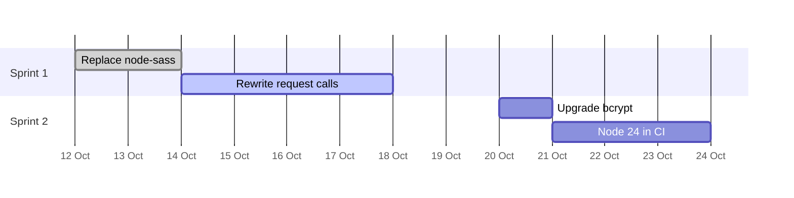

# Plan: move billing-service to Node 24

<!-- prettier-ignore -->
> [!TIP]
> Approved by the team on 12 October. atlas works through the steps in order
> and ticks them off as it goes.

## Main change

```ts
// before
request.get(url, (err, res, body) => done(JSON.parse(body)))

// after
const body = await fetch(url).then(res => res.json())
```

## Steps

- [x] Replace `node-sass` with `sass`
- [ ] Rewrite the `request` calls with `fetch`
- [ ] Upgrade `bcrypt` to 6
- [ ] Run the test suite on Node 24

```bash
pnpm remove node-sass && pnpm add -D sass
pnpm up bcrypt@^6
nvm use 24 && pnpm test
```

## Timeline


