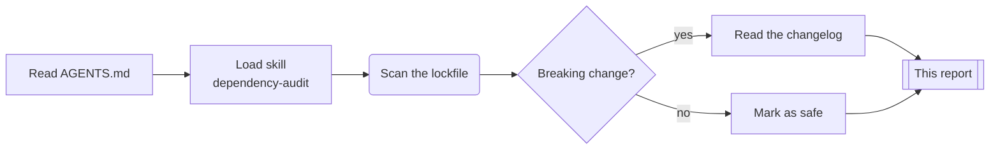
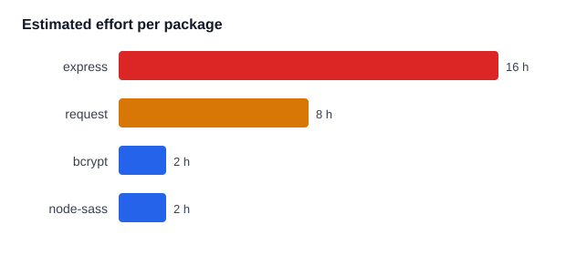

# Dependency audit: billing-service

<!-- prettier-ignore -->
> [!NOTE]
> Written by **atlas** during run `2026-10-12-0938` from `package.json`,
> the lockfile and the CI logs. It followed the team's [[decisions]].

## Verdict

`billing-service` can move to Node 24 in two sprints. Three packages need a
change first; two of them have a drop-in replacement.

| Package     | Current | Proposed | Effort | Why             |
| ----------- | ------: | -------- | :----: | --------------- |
| `node-sass` |   7.0.3 | `sass`   |   S    | Deprecated      |
| `request`   |  2.88.2 | `fetch`  |   M    | Deprecated      |
| `bcrypt`    |   5.0.1 | 6.0.0    |   S    | Major behind    |
| `express`   |  4.19.2 | 5.1.0    |   L    | Routing changes |

## How atlas worked

## Next steps

- [x] Replace `node-sass` with `sass`
- [x] Draft the plan: [[2026-10-12-node24-migration]]
- [ ] Rewrite the 14 `request` calls with `fetch`
- [ ] Get a human review of the `express` 5 upgrade[^review]

<!-- prettier-ignore -->
> [!WARNING]
> atlas did not run the integration tests against `express` 5.

[^review]: `AGENTS.md` requires a human review for any major upgrade.
