# Mermaid looks, layouts and themes

A tour of every **look**, **layout** and **theme** in the Mermaid build bundled
with md-reader (Mermaid 12). Each diagram overrides md-reader's defaults with a
frontmatter `config` block at the top of the fence, which you can copy into your
own diagrams:

```text
---
config:
  look: neo
  layout: elk
  theme: forest
---
flowchart TD
  A --> B
```

md-reader's page-wide defaults are set in the extension popup under
**Mermaid look** (Classic, Hand-drawn, Neo) and **Mermaid layout** (Dagre, ELK,
ELK tree), and start as `classic` + `dagre`, matching Mermaid 9. The Mermaid
theme follows the page theme (light or dark). A diagram's own `config:` block
always wins over those defaults, which is how every example below works.

- [Looks](#looks)
- [Looks on other diagram types](#looks-on-other-diagram-types)
- [Layouts](#layouts)
- [Themes](#themes)
- [Pairings](#pairings)

## Looks

`look` changes how shapes and edges are drawn, not where they go. It applies to
flowcharts, state, class, ER, sequence and most other diagram types.

### `look: classic`

The Mermaid 9 style and md-reader's default: flat fills, thin borders.


### `look: handDrawn`

Sketchy, whiteboard-style strokes (rough.js).

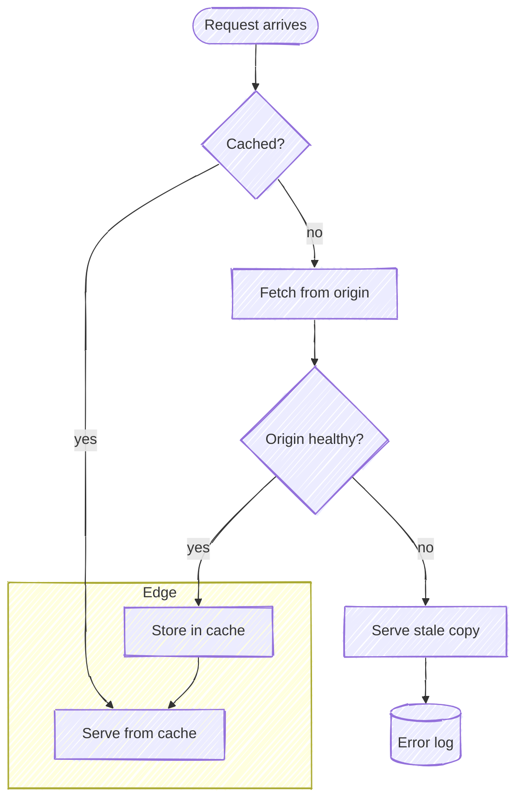

### `look: neo`

Mermaid 12's own default: rounded corners, drop shadows, bolder edges.

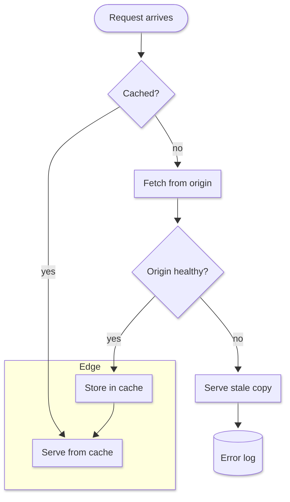

## Looks on other diagram types

The same three looks applied to sequence, state, class and ER diagrams.

### Sequence

#### Sequence — `look: classic`

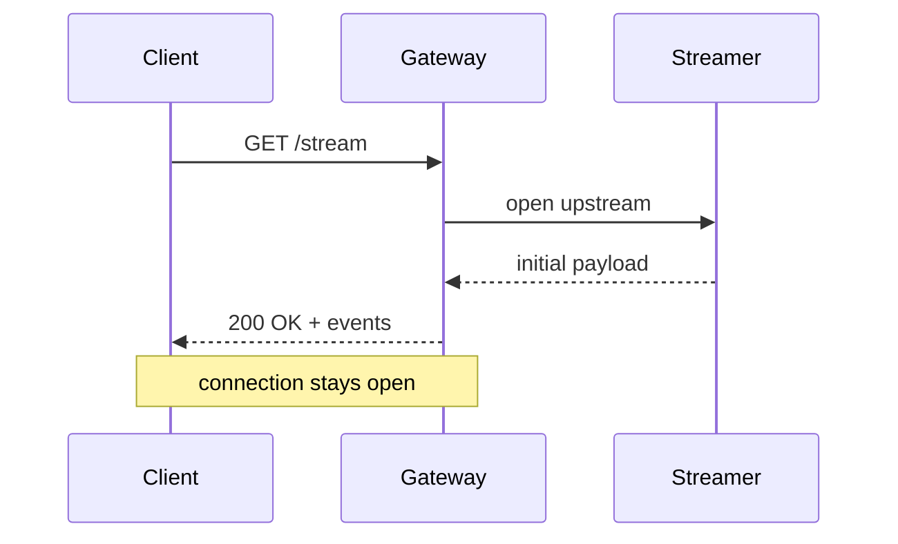

#### Sequence — `look: handDrawn`


#### Sequence — `look: neo`

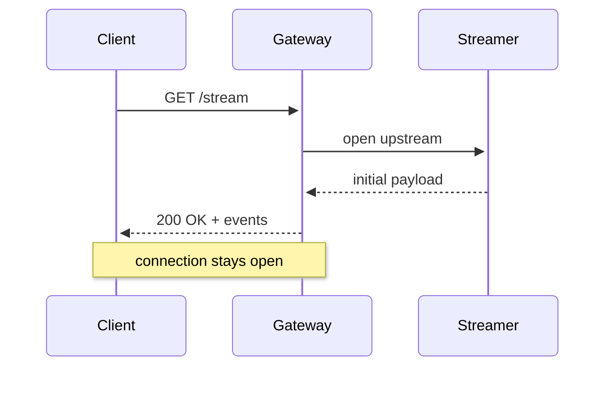

### State

#### State — `look: classic`

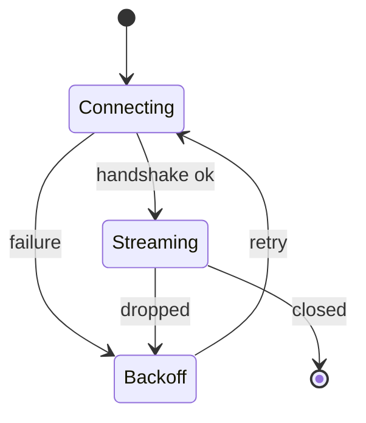

#### State — `look: handDrawn`

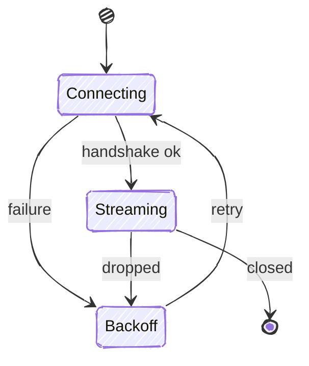

#### State — `look: neo`

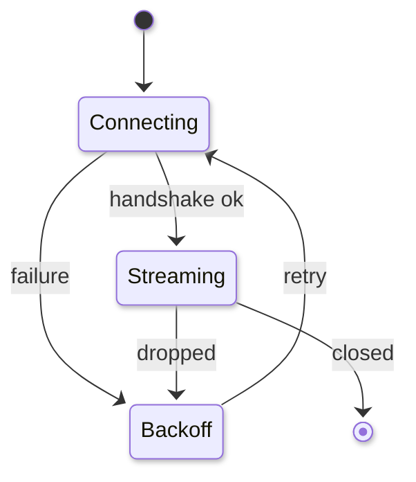

### Class

#### Class — `look: classic`

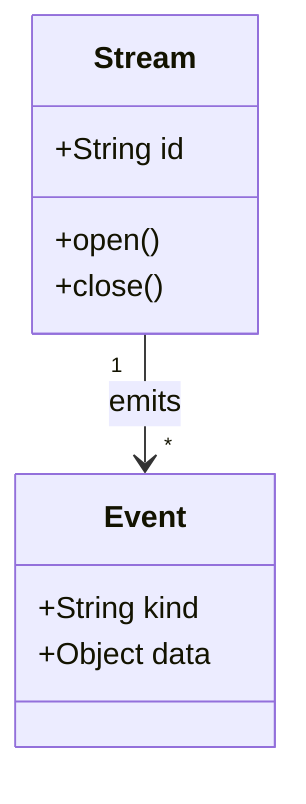

#### Class — `look: handDrawn`

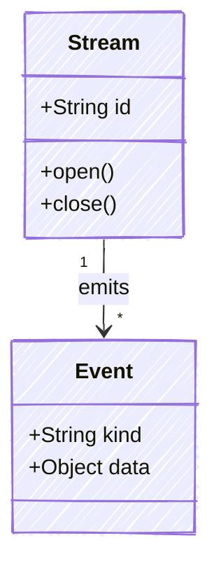

#### Class — `look: neo`

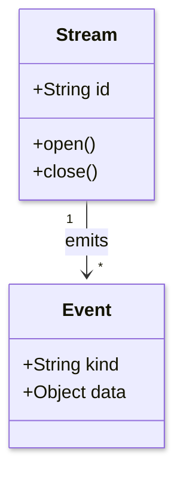

### ER

#### ER — `look: classic`

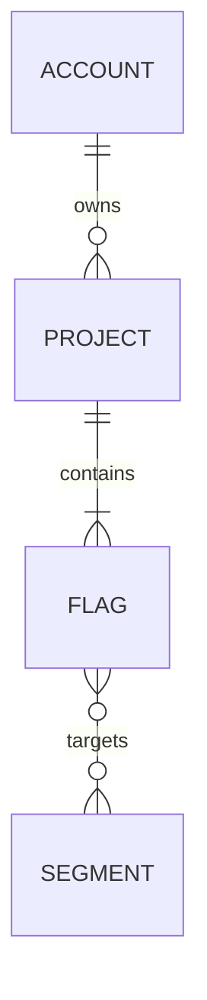

#### ER — `look: handDrawn`

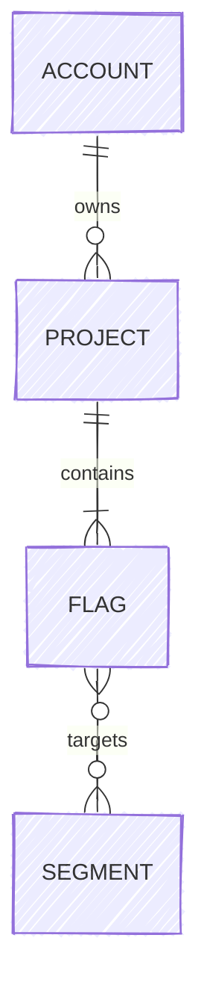

#### ER — `look: neo`

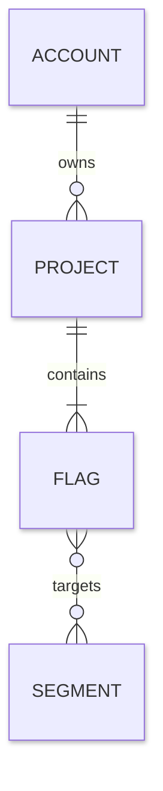

## Layouts

`layout` decides where nodes and edges go. It applies to diagrams built on
Mermaid's unified renderer (flowchart, state, class, ER); sequence diagrams
ignore it. The ELK examples use the same flowchart in the classic look, so only
the placement changes. Only `dagre`, `elk` and `elk.mrtree` are really designed
for directed flowcharts; the others are shown for completeness.

### `layout: dagre`

Layered layout with curved edges. md-reader's default and Mermaid 9's only option.

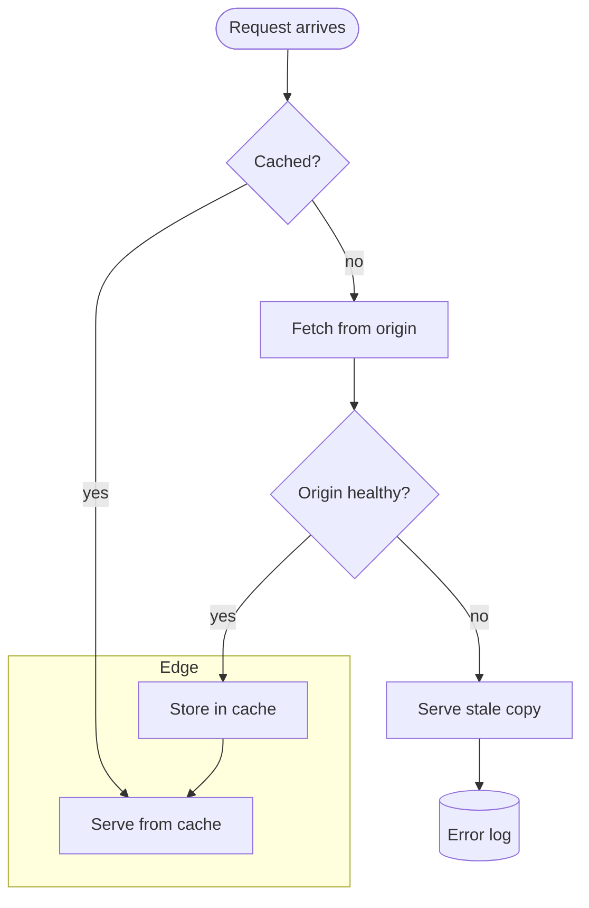

### `layout: elk`

ELK layered (`elk.layered`). Mermaid 12's default; orthogonal edges, tends to be larger.

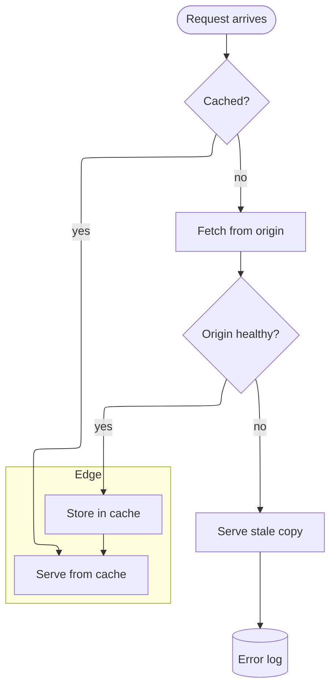

### `layout: elk.mrtree`

ELK tree layout. Best for hierarchies with few cross-links.

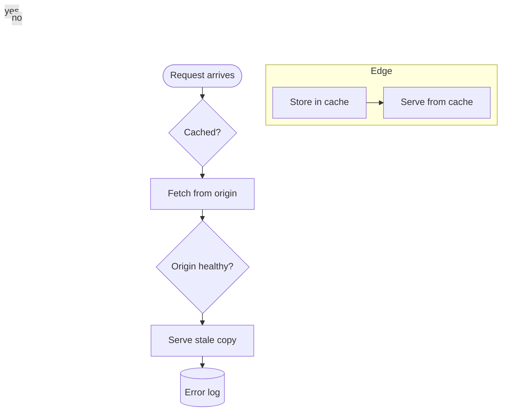

### `layout: elk.stress`

ELK stress minimisation. Undirected, spring-like placement. Built for undirected
graphs: on a flowchart it ignores edge direction and nodes can overlap.

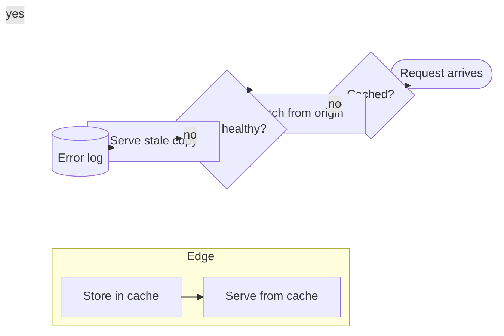

### `layout: elk.force`

ELK force-directed. Organic, unlayered placement. Like `elk.stress`, not meant
for directed flowcharts.

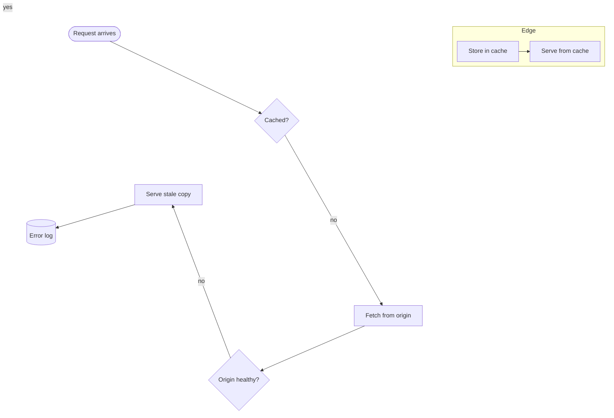

### `layout: elk.sporeOverlap`

ELK overlap removal. Keeps an initial placement but pushes overlapping nodes apart.

```mermaid
---
config:
  layout: elk.sporeOverlap
---
flowchart TD
  A([Request arrives]) --> B{Cached?}
  B -->|yes| C[Serve from cache]
  B -->|no| D[Fetch from origin]
  D --> E{Origin healthy?}
  E -->|yes| F[Store in cache]
  E -->|no| G[Serve stale copy]
  F --> C
  G --> H[(Error log)]
  subgraph Edge
    C
    F
  end
```

### `layout: elk.box`

ELK box packing. Packs nodes into a compact rectangle; ignores edge direction.

```mermaid
---
config:
  layout: elk.box
---
flowchart TD
  A([Request arrives]) --> B{Cached?}
  B -->|yes| C[Serve from cache]
  B -->|no| D[Fetch from origin]
  D --> E{Origin healthy?}
  E -->|yes| F[Store in cache]
  E -->|no| G[Serve stale copy]
  F --> C
  G --> H[(Error log)]
  subgraph Edge
    C
    F
  end
```

### `layout: elk.rectpacking`

ELK rectangle packing. Similar to box, row-based.

```mermaid
---
config:
  layout: elk.rectpacking
---
flowchart TD
  A([Request arrives]) --> B{Cached?}
  B -->|yes| C[Serve from cache]
  B -->|no| D[Fetch from origin]
  D --> E{Origin healthy?}
  E -->|yes| F[Store in cache]
  E -->|no| G[Serve stale copy]
  F --> C
  G --> H[(Error log)]
  subgraph Edge
    C
    F
  end
```

### `layout: cose-bilkent`

Cytoscape's force-directed layout. Mermaid uses it for **mindmaps**, which have
a single root; it fails on flowcharts ("Root node is required"), so this
example is a mindmap.

```mermaid
---
config:
  layout: cose-bilkent
---
mindmap
  root((Streaming))
    Transport
      HTTP/2
      HTTP/3
    Gateway
      Admission
      Routing
    Clients
      Mobile
      Browser
```

### `layout: swimlane`

Turns each top-level `subgraph` into a lane. It needs subgraphs to do anything
useful, so this example uses a different flowchart.

```mermaid
---
config:
  layout: swimlane
---
flowchart LR
  subgraph Client
    A([Open app]) --> B[Request stream]
  end
  subgraph Gateway
    C[Authenticate] --> D{Admit?}
  end
  subgraph Backend
    E[Build payload] --> F[(Store)]
  end
  B --> C
  D -->|yes| E
  D -->|no| B
  E --> B
```

For comparison, the same flowchart with the default `dagre` layout:

```mermaid
---
config:
  layout: dagre
---
flowchart LR
  subgraph Client
    A([Open app]) --> B[Request stream]
  end
  subgraph Gateway
    C[Authenticate] --> D{Admit?}
  end
  subgraph Backend
    E[Build payload] --> F[(Store)]
  end
  B --> C
  D -->|yes| E
  D -->|no| B
  E --> B
```

## Themes

`theme` sets the colour palette. These are all in the classic look so only the
colours change. The `neo` and `redux` families were designed with `look: neo`
in mind; see [Pairings](#pairings).

### `theme: default`

```mermaid
---
config:
  theme: default
---
flowchart TD
  A([Request arrives]) --> B{Cached?}
  B -->|yes| C[Serve from cache]
  B -->|no| D[Fetch from origin]
  D --> E{Origin healthy?}
  E -->|yes| F[Store in cache]
  E -->|no| G[Serve stale copy]
  F --> C
  G --> H[(Error log)]
  subgraph Edge
    C
    F
  end
```

### `theme: neutral`

```mermaid
---
config:
  theme: neutral
---
flowchart TD
  A([Request arrives]) --> B{Cached?}
  B -->|yes| C[Serve from cache]
  B -->|no| D[Fetch from origin]
  D --> E{Origin healthy?}
  E -->|yes| F[Store in cache]
  E -->|no| G[Serve stale copy]
  F --> C
  G --> H[(Error log)]
  subgraph Edge
    C
    F
  end
```

### `theme: forest`

```mermaid
---
config:
  theme: forest
---
flowchart TD
  A([Request arrives]) --> B{Cached?}
  B -->|yes| C[Serve from cache]
  B -->|no| D[Fetch from origin]
  D --> E{Origin healthy?}
  E -->|yes| F[Store in cache]
  E -->|no| G[Serve stale copy]
  F --> C
  G --> H[(Error log)]
  subgraph Edge
    C
    F
  end
```

### `theme: base`

```mermaid
---
config:
  theme: base
---
flowchart TD
  A([Request arrives]) --> B{Cached?}
  B -->|yes| C[Serve from cache]
  B -->|no| D[Fetch from origin]
  D --> E{Origin healthy?}
  E -->|yes| F[Store in cache]
  E -->|no| G[Serve stale copy]
  F --> C
  G --> H[(Error log)]
  subgraph Edge
    C
    F
  end
```

### `theme: dark`

```mermaid
---
config:
  theme: dark
---
flowchart TD
  A([Request arrives]) --> B{Cached?}
  B -->|yes| C[Serve from cache]
  B -->|no| D[Fetch from origin]
  D --> E{Origin healthy?}
  E -->|yes| F[Store in cache]
  E -->|no| G[Serve stale copy]
  F --> C
  G --> H[(Error log)]
  subgraph Edge
    C
    F
  end
```

### `theme: neo`

```mermaid
---
config:
  theme: neo
---
flowchart TD
  A([Request arrives]) --> B{Cached?}
  B -->|yes| C[Serve from cache]
  B -->|no| D[Fetch from origin]
  D --> E{Origin healthy?}
  E -->|yes| F[Store in cache]
  E -->|no| G[Serve stale copy]
  F --> C
  G --> H[(Error log)]
  subgraph Edge
    C
    F
  end
```

### `theme: neo-dark`

```mermaid
---
config:
  theme: neo-dark
---
flowchart TD
  A([Request arrives]) --> B{Cached?}
  B -->|yes| C[Serve from cache]
  B -->|no| D[Fetch from origin]
  D --> E{Origin healthy?}
  E -->|yes| F[Store in cache]
  E -->|no| G[Serve stale copy]
  F --> C
  G --> H[(Error log)]
  subgraph Edge
    C
    F
  end
```

### `theme: redux`

```mermaid
---
config:
  theme: redux
---
flowchart TD
  A([Request arrives]) --> B{Cached?}
  B -->|yes| C[Serve from cache]
  B -->|no| D[Fetch from origin]
  D --> E{Origin healthy?}
  E -->|yes| F[Store in cache]
  E -->|no| G[Serve stale copy]
  F --> C
  G --> H[(Error log)]
  subgraph Edge
    C
    F
  end
```

### `theme: redux-dark`

```mermaid
---
config:
  theme: redux-dark
---
flowchart TD
  A([Request arrives]) --> B{Cached?}
  B -->|yes| C[Serve from cache]
  B -->|no| D[Fetch from origin]
  D --> E{Origin healthy?}
  E -->|yes| F[Store in cache]
  E -->|no| G[Serve stale copy]
  F --> C
  G --> H[(Error log)]
  subgraph Edge
    C
    F
  end
```

### `theme: redux-color`

```mermaid
---
config:
  theme: redux-color
---
flowchart TD
  A([Request arrives]) --> B{Cached?}
  B -->|yes| C[Serve from cache]
  B -->|no| D[Fetch from origin]
  D --> E{Origin healthy?}
  E -->|yes| F[Store in cache]
  E -->|no| G[Serve stale copy]
  F --> C
  G --> H[(Error log)]
  subgraph Edge
    C
    F
  end
```

### `theme: redux-dark-color`

```mermaid
---
config:
  theme: redux-dark-color
---
flowchart TD
  A([Request arrives]) --> B{Cached?}
  B -->|yes| C[Serve from cache]
  B -->|no| D[Fetch from origin]
  D --> E{Origin healthy?}
  E -->|yes| F[Store in cache]
  E -->|no| G[Serve stale copy]
  F --> C
  G --> H[(Error log)]
  subgraph Edge
    C
    F
  end
```

## Pairings

Combinations that look the way Mermaid intends.

### `look: neo` + `theme: neo`

```mermaid
---
config:
  look: neo
  theme: neo
---
flowchart TD
  A([Request arrives]) --> B{Cached?}
  B -->|yes| C[Serve from cache]
  B -->|no| D[Fetch from origin]
  D --> E{Origin healthy?}
  E -->|yes| F[Store in cache]
  E -->|no| G[Serve stale copy]
  F --> C
  G --> H[(Error log)]
  subgraph Edge
    C
    F
  end
```

### `look: neo` + `theme: redux-color` (Mermaid 12's out-of-the-box default)

```mermaid
---
config:
  look: neo
  theme: redux-color
---
flowchart TD
  A([Request arrives]) --> B{Cached?}
  B -->|yes| C[Serve from cache]
  B -->|no| D[Fetch from origin]
  D --> E{Origin healthy?}
  E -->|yes| F[Store in cache]
  E -->|no| G[Serve stale copy]
  F --> C
  G --> H[(Error log)]
  subgraph Edge
    C
    F
  end
```

### `look: neo` + `theme: neo-dark`

```mermaid
---
config:
  look: neo
  theme: neo-dark
---
flowchart TD
  A([Request arrives]) --> B{Cached?}
  B -->|yes| C[Serve from cache]
  B -->|no| D[Fetch from origin]
  D --> E{Origin healthy?}
  E -->|yes| F[Store in cache]
  E -->|no| G[Serve stale copy]
  F --> C
  G --> H[(Error log)]
  subgraph Edge
    C
    F
  end
```

### `look: handDrawn` + `theme: neutral`

```mermaid
---
config:
  look: handDrawn
  theme: neutral
---
flowchart TD
  A([Request arrives]) --> B{Cached?}
  B -->|yes| C[Serve from cache]
  B -->|no| D[Fetch from origin]
  D --> E{Origin healthy?}
  E -->|yes| F[Store in cache]
  E -->|no| G[Serve stale copy]
  F --> C
  G --> H[(Error log)]
  subgraph Edge
    C
    F
  end
```

### `look: neo` + `layout: elk` + `theme: redux-color`

What an unconfigured Mermaid 12 install renders, including the layout.

```mermaid
---
config:
  look: neo
  layout: elk
  theme: redux-color
---
flowchart TD
  A([Request arrives]) --> B{Cached?}
  B -->|yes| C[Serve from cache]
  B -->|no| D[Fetch from origin]
  D --> E{Origin healthy?}
  E -->|yes| F[Store in cache]
  E -->|no| G[Serve stale copy]
  F --> C
  G --> H[(Error log)]
  subgraph Edge
    C
    F
  end
```
